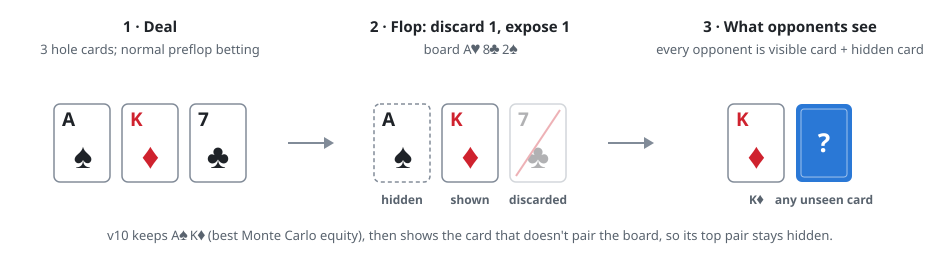
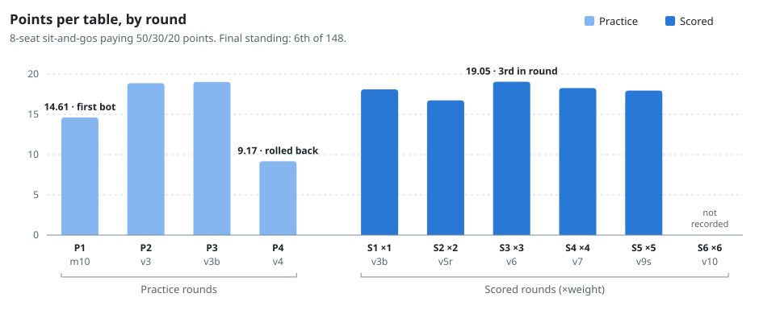
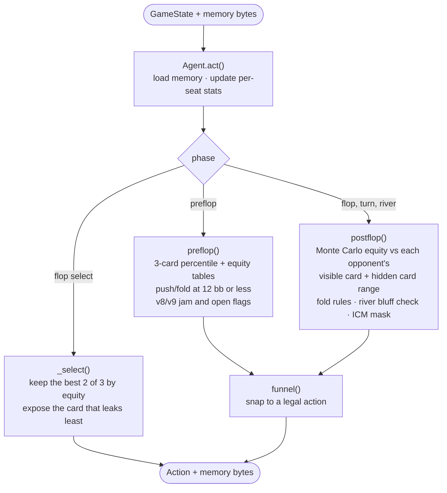
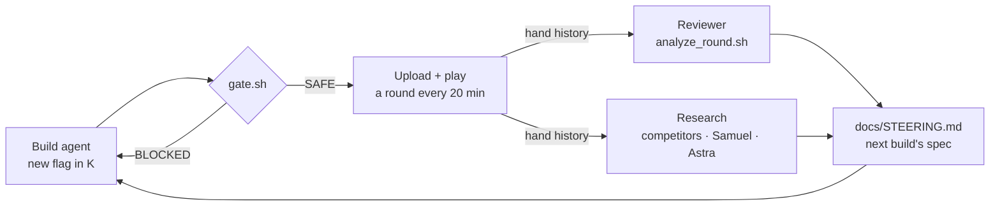

<div align="center">

# NO LIMIT

**Team avalon's pokerbot for No Limit 2026's three-card discard-and-reveal variant, with the release gate and hand-history tooling that took it from 31st in the first practice round to 6th of 148.**

[Write-up (PDF)](docs/writeup/avalon-writeup.pdf) · [Results](#results) · [How the bot decides](#how-the-bot-decides) · [How the night was run](#how-the-night-was-run) · [Engineering notes](#engineering-notes) · [Run it](#run-it-locally)

<br/>

| **6th / 148** | **3rd** | **0** | **15** |
| :---: | :---: | :---: | :---: |
| final standing | best scored round<br/>(round 3, ×3 weight) | failed decisions<br/>in all six scored rounds | release builds<br/>in one night |

</div>

<br/>

<picture>
  <source media="(prefers-color-scheme: dark)" srcset="assets/readme/variant-dark.svg">
  
</picture>

## What this is

The No Limit pokerbot tournament ran on 2026-11-06. Each team uploaded a Python agent, and the organizers played it against the other teams' agents in 8-seat sit-and-gos. A new round started every 20 minutes. The variant, `flop_discard_reveal`, deals three hole cards. On the flop each player discards one card and exposes one of the two it keeps, so after the flop every opponent holds **one visible card and one hidden card**.

This repo is everything team avalon built that night:
- every bot version and the exact zips we uploaded;
- the release gate every build had to pass;
- the scripts that analyzed each round's hand histories within seconds of download;
- the research behind each change, and the time-stamped decision log.

The bot was written from scratch during the event. The only inputs were the knowledge docs in [`rebuild/`](rebuild/); no prepared code was used.

**Rules that shaped the design**
- Each decision gets a 1 ms limit plus a 100 ms time bank, and the upload test runs with **no** bank.
- Tables pay 50/30/20 points for 1st/2nd/3rd.
- Six scored rounds were weighted ×1 through ×6.

## Results

<picture>
  <source media="(prefers-color-scheme: dark)" srcset="assets/readme/results-dark.svg">
  
</picture>

| Round | Bot | Points / table | Round rank | Notes |
| :--- | :--- | ---: | ---: | :--- |
| Practice 1 | m10 | 14.61 | 31 / 92 | minute-10 bot, rules first |
| Practice 2 | v3 | 18.87 | 8 / 116 | |
| Practice 3 | v3b | 19.02 | 7 / 123 | |
| Practice 4 | v4 | 9.17 | 100 / 125 | **rolled back** within one round ([why](#a-release-gate-that-doesnt-trust-local-wins)) |
| **Scored 1** (×1) | v3b | 18.10 | 13 | |
| **Scored 2** (×2) | v5r | 16.73 | 14 | the field got tougher |
| **Scored 3** (×3) | v6 | **19.05** | **3** | flop/turn fold rules |
| **Scored 4** (×4) | v7 | 18.26 | 6 | ICM bug live (unknown at the time) |
| **Scored 5** (×5) | v9s | 17.95 | 6 | ICM bug still live |
| **Scored 6** (×6) | v10 | 17.53 | 7 | ICM bug fixed |
| **Final** | | | **6 / 148** | 376.71 weighted points, 4.54 behind 5th |

The [write-up](docs/writeup/avalon-writeup.pdf) has the full post-event analysis of all six rounds. In short:
- **Rounds 1-2 decided our place.** After round 2 we trailed the teams that finished 3rd-5th by 8.5-11.1 weighted points; over rounds 3-6 we outscored all three.
- **Round 6's dip came from the field, not v10.** Opponents 3-bet our opens more, and one team switched to a hyper-aggressive bot that cost us 3.8 points per table at its tables.

## How the bot decides

The live bot is [`bots/v10/agent.py`](bots/v10/agent.py): one file that imports only the standard library, the SDK and `eval7`, with its lookup tables embedded so the upload can't miss a data file.



1. **Platform.** `Agent.act` starts a per-call clock and loads the memory envelope, a JSON blob of at most 12 KB. It then updates each opponent's fold, bet and raise counts from the event stream (`update_stats`). Any exception falls back to `passive()` (check if possible, else fold), so a bug never becomes a timeout or an illegal action.
2. **Flop selection.** `select_choice` scores the three ways to keep two cards by Monte Carlo equity against a best-2-of-3-style range. `expose_index` then shows the kept card that leaks least: the one that doesn't pair the board, else the one outside a flush draw, else the lower one.
3. **Preflop.** `canon3` reduces a 3-card hand to its suit pattern and looks up its percentile and its equity against several range widths in the embedded table (built by [`tools/build_tables.py`](tools/build_tables.py)). Open widths depend on how many players are left to act. At 12 bb or less the bot plays push/fold. The v8/v9 flags can then turn specific folds into jams or opens.
4. **Postflop.** Each opponent's range is their visible card plus every unseen card, cut down by their actions this hand and their stats so far (`villain_range`). Equity is multiplied across opponents. The v6 rules fold air and weak pairs heads-up to flop and turn bets, and never bet into a visible pair. The v5 rule assumes almost no folds from an opponent whose visible card already beats us. The ICM call mask applies only at 4-5 players alive (`icm_on`).
5. **Legality.** `funnel` maps the chosen kind and amount onto the nearest legal action. Raises are clamped to the legal range, and a raise that isn't legal becomes a call or a check.

Every strategy change after v3 sits behind its own flag in the `K` dict at the top of the file. A flag-flip variant (v3b, v5r, v8b, v9s, v10) was a one-line, low-risk build.

### Version history

| Version | What changed | Evidence / outcome |
| :--- | :--- | :--- |
| m10 | Minute-10 bot: keep the best 2 of 3 on the flop; tight preflop; bet or call with top pair+ | Rules-safe live bot within 10 minutes |
| v2 | 3-card preflop percentile tables; flop selection by Monte Carlo equity; opponent ranges = visible card + 1 hidden | |
| v3 | Fold-to-bet prior 0.45 (from real field data); tighter opens; 50/50 reveal | Practice 2: 18.87 |
| v3b | v3 + least-leak reveal | Practice 3: 19.02; scored 1: 18.10 |
| v4 | One value function + softmax over all actions | **Failed:** it 3-bet 58% of the time when facing a raise, regardless of cards, then folded 96% to 4-bets. It beat our own older bots locally by +4.4 |
| v5 / **v5r** | v3 + no river bluffs into visible strength (v5 also had an ICM call mask, which v5r drops) | River fix confirmed: those bluffs got 10.5% folds and lost 4.3 bb each |
| **v6** | + `visible_pair_rule` + `fold_weak_vs_hu_bet` | Three independent studies agreed. Scored 3: **19.05**. Flop fold-to-bet went from 22% to 59% |
| v7 | + hide top pair (`reveal_random: False`), ICM call mask, BB folds vs non-SB opens | Scored 4: 18.26. The BB folds turned out obsolete after v6 |
| v8 / v8b | + heads-up jam widening, heads-up broadway/Ax opens, wider late steals; v8b turns the BB folds off | Practice 8: 17.82 (steals suspected) |
| v9 / **v9s** | + BB jams vs late opens; v9s turns the steals off | Scored 5: 17.95 |
| **v10** | v9s + **ICM bug fix**: the mask applies only at 4-5 alive | [See below](#the-icm-bug-a-library-function-nobody-tested) |

## How the night was run

Several roles worked in parallel. The humans uploaded builds and relayed research between them.



| Role | Who | Output |
| :--- | :--- | :--- |
| **Build agent** | Claude | wrote the bots, ran its own tests, packed `releases/<name>.zip` ([`docs/BUILDLOG.md`](docs/BUILDLOG.md)) |
| **Reviewer** | Claude | gated every release, analyzed each round's hand history, steered the build agent ([`docs/STEERING.md`](docs/STEERING.md)); built the flag-flip variants v3b, v5r, v8b, v9s and v10 |
| **Competitor research** | Claude | forward-EV studies of our decisions and the top teams' ([`research/competitors/`](research/competitors/)) |
| **Matched-hand studies** | Samuel (with Claude) | the BB, heads-up jam and reveal experiments, and the heads-up ICM symptom |
| **Variant math** | Astra (Codex) | the handoff and round-2 review in [`research/`](research/) |

**Per-round deadlines:**
- 15 minutes before: rules locked.
- 8 minutes before: release packed.
- 6 minutes before: release gated.
- 3 minutes before: uploaded.

A missed deadline meant the previous bot stayed live.

## Engineering notes

### Fitting a decision into 1 ms with no time bank

- **Problem:** The upload test gives each decision 1 ms and no bank. Monte Carlo equity against several opponents takes longer than that. The first upload of `agent.py` on its own also failed with `FileNotFoundError` on its table file.
- **Approach:**
  - **Precompute.** Preflop is a table lookup. The 3-card tables and a heads-up 2-card equity table are embedded in `agent.py` as literals.
  - **Deadline.** Postflop and flop selection check a 0.3 ms deadline (`DEADLINE_S`) inside their loops. Opponents not reached in time get an approximated equity instead of a timeout.
  - **Startup.** An import-time warm-up (`_warm()`) runs one decision of each kind. Then `gc.freeze()` and raised GC thresholds keep garbage collection from landing on a real decision.
- **Why:** A missed decision costs far more than a slightly noisier equity estimate. Embedding the tables makes the upload a single file that can't be packed wrong.
- **Tradeoff:** Equity runs on only 120-300 Monte Carlo iterations (`post_iters`, `sel_iters`), so close spots are decided on noisy numbers. The embedded tables make `agent.py` a 150 KB file, most of it data.

### A release gate that doesn't trust local wins

- **Problem:** v4 beat our own older bots locally by +4.4 points a table, then scored 9.17 in the real field (100th of 125). It 3-bet 58% of the time when facing a raise, whatever its cards, and folded 96% to 4-bets. Its local tests had only played it against our own bots.
- **Approach:** [`reviewer/gate.sh`](reviewer/gate.sh) runs five checks and prints `SAFE` or `BLOCKED`:
  1. A rules check.
  2. The upload test under real conditions: no bank, 5 seeds.
  3. An 8-seat local match.
  4. Optionally, the same test on tournament-like hardware.
  5. A behavior diff against v3b, the last proven bot ([`bdiff.sh`](reviewer/bdiff.sh) and [`behavior.py`](reviewer/behavior.py)). Both bots play identical tables against field-proxy opponents (stations, a maniac, TAGs and older builds), and every preflop and first-flop decision rate is compared. VPIP outside 22-35% or PFR outside 17-27% blocks the release; these bands come from the real field. Any other rate that moves more than 10 points must be an intended change.
- **Why:** What a change does to behavior shows whether it's safe. A local win rate against our own bots doesn't.
- **Tradeoff:** The bands are conservative and could block a legitimately more aggressive bot. The gate also takes a few minutes of a 20-minute cycle.

### The ICM bug: a library function nobody tested

- **Problem:** `poker_agent_sdk.icm()` scores a busted stack as 0 points even when the bust place pays: `icm([0, 4000], [50, 30, 20])` returns `[0.0, 50.0]`, but busting heads-up still pays 30. From v7 on, the bot used it to mask all-in calls. Heads-up, that made the bot demand about 88% equity to call where about 45% is correct, so it folded profitable calls in rounds 4 and 5.
- **Approach:** Samuel's matched-hand data showed the bot folding heads-up all-in spots. Our study of all-in calls with 2-3 alive ([`hucall.py`](reviewer/hucall.py)) found calling beat folding by +0.3 to +2.3 points per call. Tracing the fold threshold led to the SDK function. v10 limits the mask to 4-5 players alive (`icm_on`), where the bust place is unpaid and the SDK's assumption is correct.
- **Why:** It was the smallest change that removed the wrong region with minutes to go before the ×6 round. Re-deriving ICM under that time pressure was riskier.
- **Tradeoff:** At 2-3 alive the bot has no ICM adjustment at all and plays on chip EV. The post-event analysis puts the bug's cost at about 1.4 weighted points (0.9-1.7); on the night we guessed 2-2.5.

## Findings that held up (real field, multiple rounds)

- **Fold more to flop and turn bets.** Calling heads-up with air, middle pair or one pair against a visible pair lost 1.6-6.3 bb per call. Folding these was worth about +2.3 points a round.
- **Never bluff into visible strength.** When an opponent's exposed card plus the board already beats us, they fold only 8-15% of the time.
- **Hide top pair.** Randomized round-2 data: revealing it cost 0.27 ± 0.05 points per hand at the time.
- **Our preflop jams beat folding in every spot and strength band** (112k jams). Value-jamming strong hands earns less than raising them, because the field folds to jams.
- **Heads-up and 3-handed all-in calls beat folding** (+0.3 to +2.3 points per call). That's what exposed the ICM bug.
- **Rules have a shelf life.** BB calls against CO/BTN opens lost points before v6 and broke even or won after it. Re-check old rules after big changes.

## Lessons

1. **Judge changes on real-field hand data from the first practice round.** The flop-calling leak was live through scored round 2. Fixing it earlier would have been worth about 4-7 weighted points, more than our final 4.54-point gap to 5th.
2. **Unit-test every library function a decision depends on,** with edge cases such as 2 players, busted stacks and paid places.
3. **Local wins against your own old bots mean nothing.** Gate on a behavior diff against the last *proven* bot, plus VPIP/PFR bands from the real field.
4. **1,000-table samples swing by ±2 points.** Practice rounds also ran 1.5-2 points high, so compare same-file or scored results only.
5. **Track how the field responds to you, not just your own VPIP and PFR.** We folded to 82-87% of 3-bets all night while the field's 3-bet rate nearly doubled. After v6 we also folded to heads-up bets 20-30 points more often than the field. The gate watched neither, so neither got fixed.

## Repository structure

```text
├── bots/<version>/          agent.py (+ tables) for every build, including test variants (26)
├── releases/<version>.zip   the exact zips uploaded or considered (15) + LATEST.txt
├── reviewer/                gate.sh, bdiff.sh + behavior.py, analyze_round.sh, and the hand-history
│                            analyses (hh*.py, x*.py; each starts with a docstring saying what it measures)
├── tests/                   match.py (local matches; --bank 0 = upload-test conditions), fuzz.py,
│                            validate.py, stats_check.py, opponents/ (field-proxy bots)
├── tools/                   table builders (3-card preflop, heads-up 2-card equity), readme_assets.py
├── research/                Astra's handoff + variant paper, the round-2 review,
│                            competitors/ (REPORT.md, scripts, outputs)
├── rebuild/                 the knowledge-only docs the bot was built from
├── docs/                    STEERING.md (decision log), BUILDLOG.md (build agent's test log),
│                            TUNING.md (v4's value-function dials), writeup/ (the write-up, LaTeX + PDF)
└── assets/readme/           README images (generated by tools/readme_assets.py)
```

## Run it locally

**Prerequisites:**
- Python 3.12.
- The official starter kit from the tournament portal, unpacked into `starter-kit/`. It provides the SDK and the local engine and isn't redistributed here.

1. **Set up the kit.** Follow its README for the exact steps; the usual setup is:
   ```bash
   cd starter-kit && python3.12 -m venv .venv && .venv/bin/pip install -r requirements.txt
   ```
2. **Play v10 under upload-test conditions:** 20 tables, no bank, against the kit's check-or-fold example.
   ```bash
   cd starter-kit && .venv/bin/python ../tests/match.py --tables 20 --bank 0 --hand-cap 20 ../bots/v10 examples/check_or_fold
   ```
3. **Gate a release.** Set `GATE_BOX=<ssh host>` to also run the no-bank test on another machine.
   ```bash
   reviewer/gate.sh releases/v10.zip
   ```
4. **Analyze a round's hand history:**
   ```bash
   reviewer/analyze_round.sh ~/Downloads/hands-<id>.jsonl.gz
   ```

To regenerate the README images, run `python3 tools/readme_assets.py`.

## Status and limits

- **Archive.** This is a snapshot of one night's work and isn't maintained. The bots are tuned to this variant and to this field.
- **Not included:**
  - Hand histories: they're large and contain other teams' play.
  - The starter kit.
- **License.** The repo is private and has no license.
